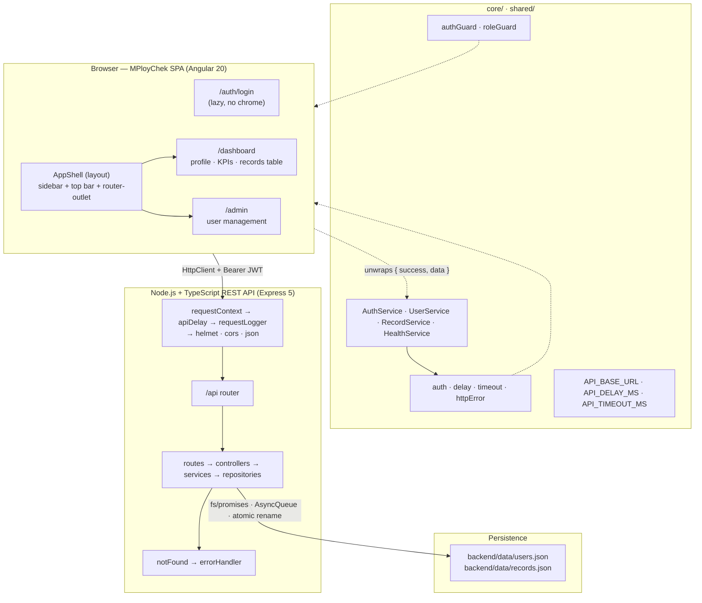
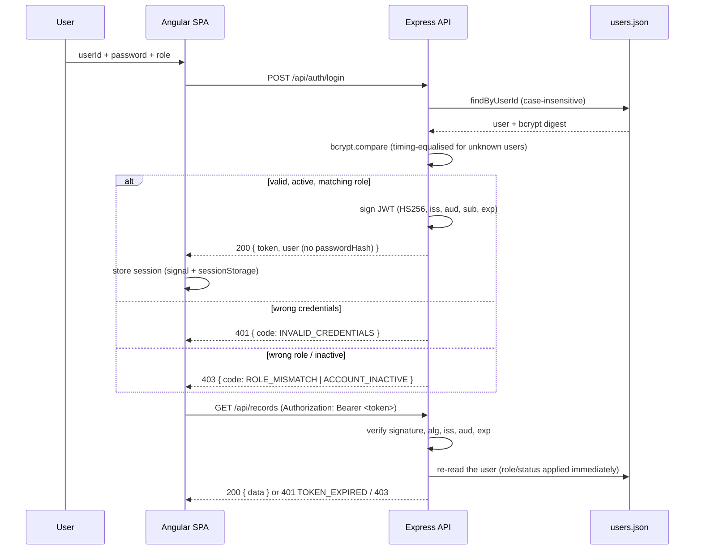

# MPloyChek — Digital Background Verification

**User Management SPA** built for the **NSQTech Private Limited** coding assessment.

An Angular single-page application talking to a Node.js + TypeScript REST API, organised so every
capability has exactly one obvious place to live. Authentication is JWT-based, authorisation is
enforced on the backend, and data is persisted to **local JSON files only** — no external database.

> **Status: Phases 1–9 complete.** The sign-in flow, the dashboard, admin user management, the
> records API, backend-enforced role-based access control, the configurable non-blocking API delay,
> the creative responsive UI and the hardening/security pass are all implemented and verified.
>
> Verified in this repository (see [Verification results](#verification-results)):
> **backend typecheck + build pass**, **frontend typecheck + production build pass**,
> **backend tests 103/103 pass**, **frontend tests 45/45 pass**, and a **live end-to-end run of 55/55
> API checks** against the compiled server.

- [Assessment checklist](ASSESSMENT_CHECKLIST.md) — every NSQTech requirement mapped to evidence.
- [Screenshot placeholders](docs/screenshots/README.md) — capture instructions (no automation tooling installed).

---

## Table of contents

1. [Assessment objectives](#assessment-objectives)
2. [Features](#features)
3. [Technology stack](#technology-stack)
4. [Architecture](#architecture)
5. [Folder structure](#folder-structure)
6. [Authentication and the JWT workflow](#authentication-and-the-jwt-workflow)
7. [Role-based authorization](#role-based-authorization)
8. [Local JSON storage design](#local-json-storage-design)
9. [Data seeding and persistence](#data-seeding-and-persistence)
10. [Prerequisites](#prerequisites)
11. [Environment variables](#environment-variables)
12. [Local installation and startup](#local-installation-and-startup)
13. [Production builds](#production-builds)
14. [Demo credentials](#demo-credentials)
15. [API documentation](#api-documentation)
16. [Request and response examples](#request-and-response-examples)
17. [API delay demonstration](#api-delay-demonstration)
18. [Testing](#testing)
19. [Verification results](#verification-results)
20. [Deployment and platform limitations](#deployment-and-platform-limitations)
21. [Screenshots](#screenshots)
22. [Security considerations](#security-considerations)
23. [Design decisions](#design-decisions)
24. [Known limitations and future improvements](#known-limitations-and-future-improvements)

---

## Assessment objectives

The assessment asked for a digital background verification product covering:

- an **Angular (12+)** single-page application;
- a **Node.js + TypeScript REST API**;
- the **User ID + Password + Role** login experience;
- the **`ADMIN`** and **`GENERAL_USER`** roles with correct, backend-enforced access control;
- a **logged-in dashboard** showing user details and background verification records;
- a **records table** (with status and risk indicators);
- **admin user management** (create, edit, activate/deactivate, delete, search, filter, paginate);
- **dummy authentication / records APIs**;
- **local JSON persistence** (explicitly permitted — no external database);
- **configurable asynchronous processing** (`?delay=<ms>`) that does not block the event loop;
- a **`UserService`** and clean modular architecture;
- a **creative, responsive, production-shaped UI**; and
- **tests and documentation**.

## Features

**Authentication & sessions**

- Login with User ID, Password and Role (typed reactive form, role selector, validation messages,
  password visibility toggle).
- JWT (`HS256`) issuing and verification; the token is attached to every API call by an HTTP
  interceptor and the session is restored on refresh.
- Session expiry is detected client-side, the expired session is cleared and the user is returned to
  the login screen; a `401` from the API does the same.

**Dashboard**

- Sidebar navigation + top bar shell with the signed-in identity and a live API health indicator.
- Profile card (`GET /api/users/me`), KPI cards, risk indicators and a responsive records table.
- A development control that drives the API's **real** asynchronous delay (0 / 1s / 3s / 5s).
- Loading skeletons, empty states and an error state with retry.

**Admin**

- User management table with avatars, role and status badges, and pagination.
- Search (debounced) plus role, status and department filters.
- Add-user and edit-user dialogs with a shared validation contract (the same rules the API enforces).
- Activate/deactivate and delete behind a confirmation dialog; a destructive action is never silent.

**Platform**

- Configurable, validated, **non-blocking** API latency (`API_DELAY_MS`, `?delay=<ms>`).
- Consistent `{ success, data, meta }` / `{ success, error, meta }` response envelope.
- Request correlation ids, structured logging and a single error taxonomy.

## Technology stack

| Layer            | Choice                                                                                  |
| ---------------- | --------------------------------------------------------------------------------------- |
| Frontend         | Angular 20.3 (standalone components, signals), Angular Material 20, RxJS 7.8, TypeScript 5.9 (`strict`) |
| Backend          | Node.js >= 20.19, Express 5, TypeScript 5.9 (`strict`)                                  |
| Auth             | `jsonwebtoken` (HS256), `bcryptjs` (bcrypt, cost 10)                                     |
| Validation       | `zod` schemas enforced by `validateBody` / `validateQuery` middleware                    |
| Persistence      | **Local JSON files** via `node:fs/promises` — no external database                       |
| Cross-cutting    | `helmet`, `cors`, `dotenv`                                                               |
| Dev runner       | `tsx watch` (backend), Angular CLI (frontend)                                            |
| Tests            | Node's built-in test runner (`node --test`), Karma + Jasmine (`ChromeHeadless`)          |

## Architecture



The two applications are independent processes that share exactly one contract: the response
envelope. [`frontend/src/app/core/models/api-response.model.ts`](frontend/src/app/core/models/api-response.model.ts)
mirrors [`backend/src/models/api-response.model.ts`](backend/src/models/api-response.model.ts) — that
single coupling is what lets either side be deployed or rewritten on its own.

### Request lifecycle

Using `GET /api/health` from the app shell as the worked example:

1. **AppShell** calls `HealthService.getReport()` and sets its status to `checking`.
2. **`apiDelayInterceptor`** adds `?delay=<ms>` when configured; **`apiTimeoutInterceptor`** starts its
   clock; **`httpErrorInterceptor`** wraps the pipeline.
3. **Express** assigns a `requestId`, applies the artificial delay and logs the request.
4. **`healthRouter` → `HealthController` → `HealthService`** builds the report.
5. **`sendSuccess`** wraps it as `{ success: true, data, meta }` and echoes `X-Request-Id`.
6. The service unwraps `data`; the component moves its status to `online` and renders the facts.
7. Any failure arrives as an `ApiHttpError` and drives the `offline` state with an actionable message.

## Folder structure

```text
angular-assignment/
├── package.json                 workspace scripts (dev, build, test, typecheck)
├── ASSESSMENT_CHECKLIST.md      requirement-by-requirement verification
├── docs/screenshots/            screenshot placeholders + capture instructions
├── backend/
│   ├── .env.example             every supported setting (safe placeholders)
│   ├── .env.test                committed test fixture (no real secrets)
│   ├── data/                    JSON store (generated; documents are gitignored)
│   ├── src/
│   │   ├── app.ts               createApp(): middleware order + route mounting
│   │   ├── server.ts            seed → listen → graceful shutdown
│   │   ├── config/              validated, frozen configuration
│   │   ├── middleware/          context, delay, logger, auth, validation, 404, errors
│   │   ├── routes/              one router per feature, mounted under /api
│   │   ├── controllers/         HTTP ⇄ service translation only
│   │   ├── services/            business rules (no Express, no fs)
│   │   ├── repositories/        the only layer that touches fs / JSON
│   │   ├── models/              domain types + PublicUser mapper
│   │   ├── validation/          zod request schemas
│   │   └── utils/               ApiError, password, logger, response helpers
│   └── tests/                   node --test suites
└── frontend/
    ├── src/
    │   ├── environments/        environment.ts (prod) + environment.development.ts
    │   ├── styles.scss          Material 3 theme + shared design tokens/primitives
    │   └── app/
    │       ├── app.config.ts    composition root (router, HttpClient, interceptors, tokens)
    │       ├── core/            guards, interceptors, models, services, tokens, utils
    │       ├── shared/          page-header, not-found, Material barrels
    │       ├── layout/          app-shell (sidebar + top bar)
    │       └── features/        auth, dashboard, admin (each a lazy boundary)
    └── angular.json             build configurations + file replacement
```

## Authentication and the JWT workflow



- **Algorithm whitelisted.** `HS256` is pinned on both sign and verify; `iss` and `aud` are validated.
- **The store is the source of truth.** `authenticate()` re-reads the user on every request, so a role
  change or a deactivation applies immediately — and a token with a tampered `role` claim cannot
  escalate privileges.
- **On the frontend**, `AuthService` is the only holder of the session; guards ask it, the interceptor
  reads its token, components read its signals. Nothing else touches storage or the token.

## Role-based authorization

Two roles are recognised: **`ADMIN`** and **`GENERAL_USER`**.

| Layer      | Mechanism                                                                                        |
| ---------- | ------------------------------------------------------------------------------------------------ |
| Backend    | `authenticate()` resolves the caller; `authorize(...roles)` / `requireAdmin()` gate a route (`403` when authenticated but not allowed) |
| Records    | Authorisation is **per row**: a `GENERAL_USER` is served only rows whose `assignedUserId` equals their own `id`; an `ADMIN` sees every row. A `userId` in the query string is ignored |
| Frontend   | `authGuard` redirects guests to `/auth/login?redirectTo=…`; `roleGuard`/`adminGuard` sends a non-admin to `/dashboard?denied=…` |
| Principle  | Hiding a link or a route is a **usability** measure — the API independently enforces every rule, so the frontend is never the security boundary |

## Local JSON storage design

**Data is stored in local JSON files, by design.** No MongoDB, DynamoDB, MySQL or any other external
database is used.

| File                        | Contents                                              | Committed? |
| --------------------------- | ----------------------------------------------------- | ---------- |
| `backend/data/users.json`   | JSON array of users, including a bcrypt `passwordHash` | No (generated) |
| `backend/data/records.json` | JSON array of background verification records          | No (generated) |
| `backend/data/.gitkeep`     | Keeps the directory in version control                 | Yes |

```
Route → Controller → Service → Repository → JSON file
```

| Layer           | Responsibility                                              | May touch `fs` / `JSON` |
| --------------- | ----------------------------------------------------------- | ----------------------- |
| `routes/`       | URL → handler, middleware chaining                           | no                      |
| `controllers/`  | HTTP ⇄ service translation                                   | no                      |
| `services/`     | Business rules: hashing, uniqueness, ownership, 404 / 409     | no                      |
| `repositories/` | All reads, writes, parsing and stringifying                   | **yes**                 |

`JsonCollectionRepository<TEntity>` is the shared base for both collections:

- reads and writes with **`fs/promises` only** (never `readFileSync` / `writeFileSync`);
- persists **atomically** — writes `*.json.<pid>.tmp` then `fs.rename`s it over the target, so a
  crash or a concurrent reader never observes a half-written document;
- serialises every operation through a single **`AsyncQueue`**, so concurrent read-modify-write cycles
  cannot interleave and lose an update;
- creates the directory and an empty `[]` document when missing, and allocates business keys
  (`USR-003`, `REC-008`) from the highest existing value; and
- re-validates every entry with `parseEntry()`, so a hand-edited file with a bad shape is **reported,
  never silently dropped or overwritten**.

| Situation                                        | Code                     | HTTP |
| ------------------------------------------------ | ------------------------ | ---- |
| Directory or file missing                         | *(recreated)*            | –    |
| File present but empty / whitespace only          | *(treated as `[]`)*      | –    |
| Malformed JSON                                    | `STORAGE_MALFORMED_JSON` | 500  |
| Document is not an array, or an entry is invalid  | `STORAGE_INVALID_DATA`   | 500  |
| Read failure (permissions, `EISDIR`, …)           | `STORAGE_READ_FAILED`    | 500  |
| Write failure (temp file, rename, disk)           | `STORAGE_WRITE_FAILED`   | 500  |

Because a malformed document makes **reads fail before any write happens**, recoverable data is never
overwritten — the file is left untouched and the error names the offending file/field.

## Data seeding and persistence

- On boot the API runs `seedService.ensureDevelopmentData()`, which **only creates what is missing**.
  It never overwrites or deletes, so **restarting the server preserves all data** — including
  creations, updates, deactivations and deletions.
- `npm run seed` (in `backend/`) is the deliberate reset: it restores the two demo accounts and
  overwrites the sixteen demo records. Anything else in the store is left untouched.
- Seeding is skipped when `SEED_USERS=false` (the default in production).

## Prerequisites

- **Node.js >= 20.19** (verified on Node **v24.15.0**, npm 12.0.2).
- A modern browser (the SPA targets current Chrome/Edge/Firefox/Safari).
- No database server, and no global tooling, is required.

## Environment variables

### Backend — `backend/.env` (see [`backend/.env.example`](backend/.env.example))

`.env` is optional: every key has a safe built-in default identical to the example.

| Key                      | Default                     | Purpose                                                    |
| ------------------------ | --------------------------- | ---------------------------------------------------------- |
| `NODE_ENV`               | `development`               | `development` \| `test` \| `production`                     |
| `APP_NAME` / `APP_VERSION` | `MPloyChek API` / `1.0.0` | Reported by `/api/health`                                   |
| `HOST` / `PORT`          | `0.0.0.0` / `3000`          | HTTP listener                                               |
| `API_PREFIX`             | `/api`                      | Mount prefix for every router                               |
| `CORS_ORIGINS`           | `http://localhost:4200,http://127.0.0.1:4200` | Allowed browser origins (`*` allows all) |
| `JSON_BODY_LIMIT`        | `1mb`                       | Maximum request body                                        |
| `LOG_LEVEL`              | `info`                      | `debug`…`silent`; JSON lines when production                |
| `API_DELAY_MS`           | `0`                         | Default artificial latency for every `/api` request         |
| `API_DELAY_MAX_MS`       | `10000`                     | Upper bound for the configured default                       |
| `JWT_SECRET`             | dev placeholder             | HMAC key. **Required, >= 32 chars, non-placeholder in production** |
| `JWT_EXPIRES_IN_SECONDS` | `3600`                      | Access token lifetime (60 … 604800)                          |
| `JWT_ISSUER`             | `mploychek-api`             | Validated `iss` claim                                        |
| `JWT_AUDIENCE`           | `mploychek-spa`             | Validated `aud` claim                                        |
| `SEED_USERS`             | `true` (`false` in prod)    | Create the demo data when missing                            |
| `STORAGE_DRIVER`         | `json-file`                 | Persistence driver (local JSON only)                         |
| `STORAGE_DIR`            | `data`                      | Directory holding the JSON documents                         |
| `STORAGE_USERS_FILE`     | `users.json`                | Users document, relative to `STORAGE_DIR`                    |
| `STORAGE_RECORDS_FILE`   | `records.json`              | Records document, relative to `STORAGE_DIR`                  |

Generate a production secret with:

```bash
node -e "console.log(require('crypto').randomBytes(48).toString('base64url'))"
```

### Frontend — `frontend/src/environments/`

The frontend is compile-time configured (Angular file replacement), so it uses TypeScript
environment files rather than a `.env` file. The deployment-critical value is **`apiBaseUrl`**.

| Key            | `environment.development.ts`  | `environment.ts` (production)          |
| -------------- | ----------------------------- | -------------------------------------- |
| `production`   | `false`                       | `true`                                 |
| `apiBaseUrl`   | `http://localhost:3000/api`   | `https://api.mploychek.example.com/api` ← set this for your deployment |
| `apiTimeoutMs` | `15000`                       | `30000`                                |
| `apiDelayMs`   | `0`                           | `0`                                    |

`angular.json` swaps the development file in for `ng serve` / `ng build --configuration development`;
a plain `ng build` compiles the production file.

### Secrets policy

- `.env` and `.env.*` are **gitignored**; only `.env.example` (placeholders) and `.env.test` (a
  fixture with no real secrets) are committed.
- No credentials, tokens or private keys are committed anywhere in the repository.
- `NODE_ENV=production` refuses to boot with a missing, placeholder or too-short `JWT_SECRET`.

## Local installation and startup

### Option A — two terminals

```bash
# Terminal 1 — Backend API -> http://localhost:3000/api/health
cd backend
npm install
npm run dev

# Terminal 2 — Frontend SPA -> http://localhost:4200
cd frontend
npm install
npm start
```

### Option B — from the repository root

```bash
npm install          # installs root, backend and frontend dependencies
npm run dev          # starts the API and the SPA together (labelled output)
```

Open <http://localhost:4200>, sign in with a [demo credential](#demo-credentials), and the API will
seed the store on first boot.

## Production builds

```bash
# Backend — compile TypeScript to backend/dist
cd backend
npm run build
npm start                       # node dist/server.js

# Frontend — optimised production bundle to frontend/dist/frontend
cd frontend
npm run build
```

From the root: `npm run build` (backend, then frontend), `npm run typecheck` (both projects).

The frontend production build emits a **separate lazy chunk per feature**
(`app-shell`, `login-page`, `dashboard`, `user-management`, `not-found`) — the measurable proof of the
modularisation requirement.

## Demo credentials

Created automatically on first boot and re-created by `npm run seed`. Passwords are bcrypt-hashed
before they reach the store — the documents never contain plain text. These are development fixtures,
not secrets. (Verified against [`backend/src/services/seed.service.ts`](backend/src/services/seed.service.ts).)

| ID        | User ID    | Password    | Role           | Department       |
| --------- | ---------- | ----------- | -------------- | ---------------- |
| `USR-001` | `admin001` | `Admin@123` | `ADMIN`        | `Administration` |
| `USR-002` | `user001`  | `User@123`  | `GENERAL_USER` | `Verification`   |

Signing in requires selecting the role that matches the account (`admin001` → **Admin**,
`user001` → **General User**).

## API documentation

All endpoints are mounted under `API_PREFIX` (default `/api`). Every response uses the envelope below.

```jsonc
// success
{ "success": true, "data": { }, "meta": { "requestId": "…", "timestamp": "…", "durationMs": 5, "delayMs": 0 } }
// failure
{ "success": false, "error": { "code": "ROUTE_NOT_FOUND", "message": "…" }, "meta": { "requestId": "…", "timestamp": "…" } }
```

| Method   | Endpoint                 | Authentication | Required role   | Purpose                                                        | Query parameters |
| -------- | ------------------------ | -------------- | --------------- | -------------------------------------------------------------- | ---------------- |
| `GET`    | `/api/health`            | Public         | –               | Liveness/readiness report (service, env, uptime, store paths)   | `delay`          |
| `POST`   | `/api/auth/login`        | Public         | –               | Exchange userId + password + role for a JWT                    | –                |
| `GET`    | `/api/users/me`          | Bearer JWT     | Any authenticated | The caller's own profile                                     | –                |
| `GET`    | `/api/users`             | Bearer JWT     | `ADMIN`         | List users (passwords omitted)                                 | `page`, `limit`, `search`, `role`, `status`, `department` |
| `GET`    | `/api/users/:id`         | Bearer JWT     | `ADMIN`         | One user                                                       | –                |
| `POST`   | `/api/users`             | Bearer JWT     | `ADMIN`         | Create a user → `201`                                          | –                |
| `PATCH`  | `/api/users/:id`         | Bearer JWT     | `ADMIN`         | Update name / email / role / department / password             | –                |
| `PATCH`  | `/api/users/:id/status`  | Bearer JWT     | `ADMIN`         | Activate or deactivate an account                              | –                |
| `DELETE` | `/api/users/:id`         | Bearer JWT     | `ADMIN`         | Delete a user                                                  | –                |
| `GET`    | `/api/records`           | Bearer JWT     | Any authenticated | Records: own for a `GENERAL_USER`, all for an `ADMIN`       | `page`, `limit`, `search`, `status`, `riskLevel`, `verificationType`, `delay` |
| `GET`    | `/api/records/:id`       | Bearer JWT     | Any authenticated | One record — `403` when not assigned to the caller          | –                |

**Records query parameters:** `page` (default `1`), `limit` (default `10`, **max `100`**), `search`
(candidate name / company / location / verification type, case-insensitive), `status`
(`PENDING` \| `IN_PROGRESS` \| `COMPLETED` \| `FAILED`), `riskLevel` (`LOW` \| `MEDIUM` \| `HIGH`),
`verificationType` (`Employment` \| `Education` \| `Identity` \| `Address` \| `Criminal`) and
`delay` (`0`…`10000` ms). An invalid value returns `400`; an unknown `userId` parameter is ignored
because access is always decided from the JWT.

**Users query parameters:** `page` (default `1`), `limit` (default `10`, max `100`), `search`, and
`role` / `status` / `department` filters. Invalid values return `400`.

**Status codes**

| Code  | When                                                                                     |
| ----- | ---------------------------------------------------------------------------------------- |
| `200` | Successful read/update/login                                                             |
| `201` | A user was created                                                                       |
| `400` | Validation failure (`VALIDATION_ERROR` with a per-field breakdown) or `INVALID_DELAY`     |
| `401` | Wrong password, unknown user, or a missing / malformed / expired / foreign token          |
| `403` | Valid credentials but the wrong role, an inactive account, or a record not assigned to the caller |
| `404` | Unknown route, unknown user id, or a record id that does not exist                        |
| `409` | Duplicate `userId`/`email`, or an administrator targeting their own account               |
| `413` | Body larger than `JSON_BODY_LIMIT`                                                        |
| `500` | Unexpected failure or a corrupted data file (details logged, never returned)               |

## Request and response examples

```bash
# Public health check
curl http://localhost:3000/api/health

# Sign in (admin)
curl -X POST http://localhost:3000/api/auth/login \
  -H 'content-type: application/json' \
  -d '{"userId":"admin001","password":"Admin@123","role":"ADMIN"}'
```

```jsonc
{
  "success": true,
  "data": {
    "token": "eyJhbGciOiJIUzI1NiIsInR5cCI6IkpXVCJ9…",
    "tokenType": "Bearer",
    "expiresInSeconds": 3600,
    "issuedAt": "2026-10-10T06:27:08.199Z",
    "user": {
      "id": "USR-001", "userId": "admin001", "name": "System Administrator",
      "email": "admin@mploychek.local", "role": "ADMIN",
      "department": "Administration", "status": "ACTIVE",
      "createdAt": "2026-10-01T10:00:00.000Z"
    }
  },
  "meta": { "requestId": "…", "timestamp": "…", "durationMs": 41, "delayMs": 0 }
}
```

```bash
TOKEN=$(curl -s -X POST http://localhost:3000/api/auth/login \
  -H 'content-type: application/json' \
  -d '{"userId":"user001","password":"User@123","role":"GENERAL_USER"}' \
  | node -pe 'JSON.parse(require("fs").readFileSync(0)).data.token')

# Own profile
curl http://localhost:3000/api/users/me -H "Authorization: Bearer $TOKEN"

# Own records only (a general user never sees another user's rows)
curl "http://localhost:3000/api/records?limit=10" -H "Authorization: Bearer $TOKEN"

# Accessing another user's record -> 403 RECORD_FORBIDDEN
curl http://localhost:3000/api/records/REC-011 -H "Authorization: Bearer $TOKEN"

# Admin: create, then search
ADMIN=$(curl -s -X POST http://localhost:3000/api/auth/login \
  -H 'content-type: application/json' \
  -d '{"userId":"admin001","password":"Admin@123","role":"ADMIN"}' \
  | node -pe 'JSON.parse(require("fs").readFileSync(0)).data.token')
curl "http://localhost:3000/api/users?page=1&limit=10&role=ADMIN" -H "Authorization: Bearer $ADMIN"
```

**Failure envelope**

```jsonc
// GET /api/records without a token
{
  "success": false,
  "error": { "code": "TOKEN_MISSING", "message": "An access token is required. Send it as \"Authorization: Bearer <token>\"." },
  "meta": { "requestId": "…", "timestamp": "…" }
}
```

## API delay demonstration

Latency is a first-class, parameter-driven feature — not a client-side timer.

| Layer    | Parameter                       | Effect                                                 |
| -------- | ------------------------------- | ------------------------------------------------------ |
| Backend  | `API_DELAY_MS` in `.env`        | Default latency for **every** `/api` request           |
| Backend  | `?delay=<ms>` / `?delayMs=<ms>` | Per-request override, **validated** to `0`…`10000`      |
| Frontend | `environment.apiDelayMs`        | Appended to every API call by `apiDelayInterceptor`     |
| Frontend | `environment.apiTimeoutMs`      | Upper bound before `apiTimeoutInterceptor` aborts       |

The wait is `await delay(ms)` — a promise around `setTimeout` — so **the event loop is never blocked**
and other requests continue to be served.

Measured during the live end-to-end run (against the compiled server, Windows, Node v24.15.0):

| Request                              | Measured | Result |
| ------------------------------------ | -------- | ------ |
| `GET /api/records?delay=0`           | 5 ms     | ✅     |
| `GET /api/records?delay=1000`        | 1024 ms  | ✅     |
| `GET /api/records?delay=3000`        | 3014 ms  | ✅     |
| `GET /api/records?delay=5000`        | 5019 ms  | ✅     |
| `GET /api/records?delay=abc`         | `400 INVALID_DELAY` | ✅ |
| `GET /api/health` **during** a 3 s delayed request | **2 ms** | ✅ proves non-blocking |

```bash
curl "http://localhost:3000/api/records?delay=3000" -H "Authorization: Bearer $TOKEN"   # ~3s
curl "http://localhost:3000/api/records?delay=abc"                                       # 400 INVALID_DELAY
```

The dashboard exposes this as a control (0 / 1s / 3s / 5s) so the loading skeletons are driven by
genuine latency.

## Testing

```bash
npm test                        # backend then frontend, from the repo root

# or individually
cd backend  && npm test        # node --test, isolated store from .env.test
cd frontend && npm run test:ci # Karma + Jasmine, ChromeHeadless, single run
```

| Suite                           | Covers                                                                                     |
| ------------------------------- | ------------------------------------------------------------------------------------------ |
| `backend/tests/repository.test.ts` | Missing directory/file, empty file, malformed JSON, non-array document, invalid entry, read/write failures, id allocation, concurrent creates, duplicates |
| `backend/tests/persistence.test.ts` | Document shape (users + records) and durability across a simulated restart              |
| `backend/tests/users.admin.test.ts` | RBAC (401/403), listing/filtering/pagination, create/update/status/delete, duplicate 409s, empty-patch 400, injected `id`/`passwordHash` ignored, self-protection |
| `backend/tests/records.test.ts`  | RBAC (own vs all, `403` for another user's record), filtering, search, pagination, delay (0/1000/3000/5000), non-blocking proof, invalid delay/pagination, token required |
| `backend/tests/auth.test.ts`     | Login 200/400/401/403, password never serialised, `/api/users/me`, missing/malformed/foreign/expired token, unknown route 404 |
| `backend/tests/auth.middleware.test.ts` | `authorize()` / `requireAdmin()`: 403 for the wrong role, 401 when unauthenticated      |
| `backend/tests/error-handler.test.ts` | 500 envelope without a stack trace, malformed JSON → 400, framework status passthrough   |
| `backend/tests/health.test.ts`   | Health endpoint, CORS and the configurable delay                                           |
| `frontend/**/*.spec.ts`          | Root component, `HealthService`, `UserService`, `RecordService`, `AuthService` + storage, guards, interceptors, the login page and the dashboard |

## Verification results

Verified on Windows, Node **v24.15.0** / npm 12, against the current source.

| Check                                                     | Command                        | Result |
| --------------------------------------------------------- | ------------------------------ | ------ |
| Backend typecheck (`src` + `tests`, strict)               | `npm --prefix backend run typecheck` | **pass** |
| Backend tests                                             | `npm --prefix backend test`    | **103 / 103 pass** (25 suites, 0 fail) |
| Backend production build (`tsc` → `dist/`)                | `npm --prefix backend run build` | **pass** |
| Frontend typecheck (app + spec configs)                   | `npm --prefix frontend run typecheck` | **pass** |
| Frontend tests (Karma, ChromeHeadless)                    | `npm --prefix frontend run test:ci` | **45 / 45 pass** |
| Frontend production build (`ng build`)                    | `npm --prefix frontend run build` | **pass**, no warnings |
| Live end-to-end API run (compiled server, real HTTP)      | custom harness (see below)      | **55 / 55 checks pass** |
| Restart durability (live: create → restart → read → delete) | custom probe                  | **PASS** |

The live run exercised, against `node dist/server.js`:

- **General-user flow** — login, `GET /users/me`, `GET /records` (only the 10 rows assigned to
  `USR-002`), own record `200`, another user's record `403`, unknown record `404`, and `403` from
  every admin endpoint.
- **Admin flow** — all 16 records, user list with pagination, create (`201`), duplicate id/email
  (`409`), edit (`200`), search + role/department filters, pagination, invalid page/limit/filter
  (`400`), deactivate → inactive login `403` → reactivate, self-deactivation/deletion (`409`), delete
  (`200`) then `404`.
- **Failures & security** — wrong password `401`, unknown user `401`, role mismatch `403`, missing
  fields `400`, missing/malformed/**expired**/foreign token `401`, unknown route `404`.
- **Delay** — `0/1000/3000/5000` measured, invalid → `400`, and non-blocking proven.
- **Storage** — `users.json`/`records.json` are arrays, digests are `$2b$10$…`, no `password` field,
  and a user created before a restart was still present afterwards.

## Deployment and platform limitations

**Backend**

1. `cd backend && npm ci && npm run build`.
2. Set `NODE_ENV=production`, a strong unique `JWT_SECRET` (>= 32 chars), `PORT`, `CORS_ORIGINS` and,
   if needed, `STORAGE_DIR` to a persistent volume. Copy `backend/.env.example` as a starting point.
3. Run `node dist/server.js` behind a reverse proxy that terminates TLS.

**Frontend**

1. Set `apiBaseUrl` in `frontend/src/environments/environment.ts` to the deployed API URL.
2. `cd frontend && npm ci && npm run build`; serve `frontend/dist/frontend/browser` as static files.
3. Configure an SPA fallback (rewrite unknown paths to `index.html`) and set the API's `CORS_ORIGINS`
   to the deployed origin.

**Limitations of local JSON persistence — read before deploying**

> The JSON store is deliberately simple and is **only appropriate for a single instance with a
> persistent filesystem**.

- **Ephemeral filesystems.** On container platforms (Heroku, Render, Cloud Run, App Runner,
  serverless/FaaS) the filesystem is reset on each deploy or restart, so `backend/data/*.json` would be
  **lost**. Mount a persistent volume/disks, or replace the repository layer with a real datastore.
- **Horizontal scaling.** Two or more processes writing the same files is **last-writer-wins**;
  concurrency is only coordinated *within* one process via `AsyncQueue`. Run a single instance, or
  move to a shared database.
- **No transactions or indexes.** Whole-document reads/writes are fine for a demo data set but do not
  scale to large collections.
- **Swapping in a database is contained.** Every read/write goes through `repositories/`; a real
  database means new repository implementations and changing which instances `services/` import — no
  controller, service, route, model or test needs to change.

## Screenshots

Browser-automation tooling (Puppeteer/Playwright) is **not installed** in this repository, so the
screenshots below are **placeholders, not real captures**. See
[`docs/screenshots/README.md`](docs/screenshots/README.md) for exact capture instructions.

| Screen                     | File                                              | Status      |
| -------------------------- | ------------------------------------------------- | ----------- |
| Login                      | `docs/screenshots/01-login.png`                   | Placeholder |
| General user dashboard     | `docs/screenshots/02-dashboard-general-user.png`  | Placeholder |
| Admin dashboard            | `docs/screenshots/03-dashboard-admin.png`         | Placeholder |
| User management            | `docs/screenshots/04-user-management.png`         | Placeholder |
| API loading state          | `docs/screenshots/05-loading-state.png`           | Placeholder |

Quick capture: run both apps (`npm run dev`), open <http://localhost:4200>, sign in, and use the
browser's built-in screenshot tool. To capture the loading state, select the dashboard's **3 seconds**
API-delay option and screenshot while the skeletons are visible.

## Security considerations

- **Passwords never leave the server.** Responses are built by `toPublicUser()`, which copies fields
  explicitly instead of spreading, so `passwordHash` cannot leak even if `User` gains fields later.
  `id`/`passwordHash` are absent from the request schemas, and unknown keys are stripped by zod.
- **bcrypt, not plain text.** Digests are `$2b$10$…` and verified with `bcrypt.compare`; a malformed
  digest behaves like a wrong password rather than throwing. Cost factor 10 (~50 ms/hash).
- **No user enumeration.** An unknown user id still runs a comparison against a cached placeholder
  digest and returns a byte-identical `401` to a wrong password.
- **Backend is the security boundary.** Authorisation is enforced per request from the store; tokens
  cannot escalate privileges via a tampered `role` claim; record access is per-row.
- **Hardened headers and CORS.** `helmet()` is applied globally and CORS uses an explicit allow list
  (`CORS_ORIGINS`); requests without an `Origin` are allowed, unlisted origins are rejected.
- **Centralised errors.** Only `ApiError` instances are exposed; unexpected errors become a generic
  `500` whose details are logged and never returned.
- **Configurable delay is validated.** Non-numeric, negative or out-of-range values return `400`
  rather than being silently clamped.
- **Production guardrails.** `NODE_ENV=production` refuses to boot with a missing/placeholder/short
  `JWT_SECRET`.
- **Secrets are not committed.** `.env`/`.env.*` are gitignored; the generated JSON documents are
  gitignored so no password digest can land in the repository.

## Design decisions

- **`createApp()` never listens.** `app.ts` builds the Express app; `server.ts` binds the port. Tests
  mount the real production app on an ephemeral port and exercise the full middleware stack.
- **One response envelope, one error taxonomy.** Clients branch on `success`, not status codes alone;
  only operational `ApiError`s are exposed.
- **Configuration is validated and frozen.** `config/env.config.ts` coerces and bounds every value and
  fails fast with the offending key, so a misconfigured deployment crashes at boot.
- **Layered backend, feature-first frontend.** `routes → controllers → services → repositories`, and
  `core/ shared/ features/`; a feature is only reachable through its lazy `*.routes.ts` entry point.
- **Signals for view state, RxJS for data flow.** Components hold `signal()` state; services return
  `Observable<T>` unwrapped from the envelope.
- **Standalone components, shared Material barrels.** No `NgModule`s; shared imports come from
  `shared/ui` so each component's dependency surface stays readable.
- **No fake data.** Every screen renders real API data; loading states are driven by genuine requests
  (the configurable latency), never simulated with client-side timers.
- **The UI is a design system, not one-off styles.** Material 3 theme plus shared tokens/primitives
  (spacing, radii, elevation, motion, badges, tables, states) keep the product visually consistent.

## Known limitations and future improvements

**Known limitations**

- Local JSON storage is single-instance only and unsuitable for ephemeral or horizontally scaled
  hosting (see [Deployment](#deployment-and-platform-limitations)).
- No refresh tokens, token revocation list or rate limiting.
- The dashboard loads up to the API's maximum page size (100) rather than paging the records table.
- Records are read-only through the UI; there is no create/edit-record screen.
- Screenshots are placeholders (no browser-automation tooling installed).

**Future improvements**

- Refresh-token rotation, a token revocation list and per-IP rate limiting.
- Server-side pagination and sorting on the dashboard records table.
- CI pipeline (typecheck + tests + build) and Playwright end-to-end tests.
- Optional pluggable persistence (Postgres) behind the existing repository interface.

---

© 2026 — built for the NSQTech Private Limited assessment. Third-party dependencies are listed in the
respective `package.json` files; all application code was written for this project.
